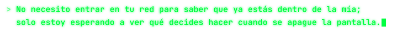

 

 

 

## GITHUB STATS

## LANGUAGES AND TOOLS

<table>
  <tr>
    <td align="center" width="120"> Python</td>
    <td align="center" width="120"> C</td>
    <td align="center" width="120"> Java</td>
    <td align="center" width="120"> JavaScript</td>
    <td align="center" width="120"> Bash</td>
    <td align="center" width="120"> PowerShell</td>
  </tr>
  <tr>
    <td align="center" width="120"> HTML5</td>
    <td align="center" width="120"> CSS</td>
    <td align="center" width="120"> Spring Boot</td>
    <td align="center" width="120"> FastAPI</td>
    <td align="center" width="120"> Flask</td>
    <td align="center" width="120"> Nginx</td>
  </tr>
  <tr>
    <td align="center" width="120"> MySQL</td>
    <td align="center" width="120"> PostgreSQL</td>
    <td align="center" width="120"> Git</td>
    <td align="center" width="120"> GitHub</td>
    <td align="center" width="120"> GH Actions</td>
    <td align="center" width="120"> VS Code</td>
  </tr>
  <tr>
    <td align="center" width="120"> Linux</td>
    <td align="center" width="120"> Ubuntu</td>
    <td align="center" width="120"> Windows</td>
    <td align="center" width="120"> Docker</td>
    <td align="center" width="120"> Cloudflare</td>
    <td align="center" width="120"> Raspberry Pi</td>
  </tr>
</table>

  
  
  
  
   
  
  
  
  
  

## WHOAMI

